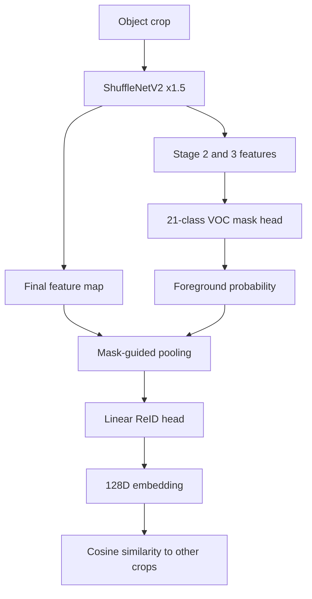

# How this project works

Start with [config.yaml](config.yaml). It chooses the datasets, training budget,
starting weights, output checkpoint, and checkpoint-selection metrics. The
short `.py` files in this directory are commands. Shared model and training
logic, preparation, video, and benchmark implementations are grouped under
`utils/`. The root contains only four Python commands.

## The model

The input is **one object crop**, currently resized to 224 × 224. Finding a
box in a full video frame is a separate task; the current demos use dataset
boxes. The trained model has one shared backbone and two outputs:



[utils/core/model.py](utils/core/model.py) contains `JointNet.forward`. The mask logits
come from stage 2 features plus stage 3 context. The embedding comes from the
final feature map, weighted by the predicted foreground. The 21 mask channels
are VOC's background plus 20 semantic classes. The mask is **semantic
foreground**, so it cannot reliably choose one person or vehicle when two
same-class objects share a crop.

## Training path

```text
python train.py
  -> read config.yaml
  -> utils/core/training.py: train()
      -> utils/core/datasets.py: open identity and VOC datasets
      -> utils/core/identity_data.py: augment crops and make P × K identity batches
      -> utils/core/model.py: forward crop through shared model
      -> identity classification + batch-hard triplet loss
      -> VOC segmentation cross-entropy on every mask_every-th step
      -> utils/core/metrics.py: measure calibration retrieval and VOC mask quality
      -> utils/core/checkpointing.py: save best model and full recovery state
  -> utils/core/evaluation.py: evaluate held-out data after training
```

The identity classifier exists **only during training**. It teaches the
128D embedding to separate known physical identities. The saved inference
model keeps the backbone, mask head, and embedding head. The VOC mask loss
updates the backbone and mask head. ReID losses update the backbone and
embedding head, and also reach the mask head through mask-guided pooling.
VRAI's calibration mAP is the largest part of the checkpoint-selection score;
its final IDs are evaluated after training. BuckTales stays test-only.

The configured output model is `checkpoints/joint_aerial_validated.pt`. The matching
`*.last.pt` file stores optimizer, scheduler, classifier, epoch, and RNG state
for a full restart. `python train.py` resumes that state when present.

## What each file is for

| File | Where to look for |
| --- | --- |
| [config.yaml](config.yaml) | Dataset paths, weights, training settings, and output paths |
| [utils/core/model.py](utils/core/model.py) | Backbone, mask head, embedding head, pooling, mask loss |
| [utils/core/datasets.py](utils/core/datasets.py) | ABO, DeepFashion, generic CSV crops, mixed identities, VOC masks |
| [utils/core/identity_data.py](utils/core/identity_data.py) | SOP crops, augmentation, P × K camera-aware sampler |
| [utils/core/training.py](utils/core/training.py) | Training steps, losses, and checkpoint selection |
| [utils/core/checkpointing.py](utils/core/checkpointing.py) | Training signature, best weights, and restart state |
| [utils/core/metrics.py](utils/core/metrics.py) | Rank-1, cross-camera mAP, VOC IoU, selection score |
| [utils/core/evaluation.py](utils/core/evaluation.py) | Final held-out ReID and VOC evaluation |
| [utils/core/tracking.py](utils/core/tracking.py) | Motion, box-overlap, and appearance score for one target |
| [utils/data_sources/](utils/data_sources/) | Dataset downloads, conversions, and CSV manifest creation |
| [utils/visualization/target_search.py](utils/visualization/target_search.py) | Selection UI, model calls, and MP4 rendering for `demo.py select` |
| [utils/visualization/video.py](utils/visualization/video.py) | VisDrone video rendering for `demo.py` |
| [utils/crossdrone/data.py](utils/crossdrone/data.py) | BuckTales pairs, crop preparation, manifest checks |
| [utils/crossdrone/retrieval.py](utils/crossdrone/retrieval.py) | BuckTales mask/global pooling retrieval |
| [utils/crossdrone/video.py](utils/crossdrone/video.py) | BuckTales selected-object MP4 |
| [utils/benchmarking/models.py](utils/benchmarking/models.py) | Comparison model loading, retrieval metrics, CPU timing |
| [utils/benchmarking/report.py](utils/benchmarking/report.py) | Benchmark HTML layout and SVG charts |
| [utils/benchmarking/figures.py](utils/benchmarking/figures.py) | Standalone benchmark PNG charts |
| [utils/experiments/compare.py](utils/experiments/compare.py) | Matched ReID-only versus joint training |

`utils/data_sources/` contains the dataset converters. `utils/visualization/`
contains the VisDrone videos and target selection. `utils/crossdrone/` handles
BuckTales data, retrieval, and video. `utils/benchmarking/` builds comparisons
and mask evaluations. `utils/experiments/` contains the matched training run.

## Commands and outputs

| Run | Purpose | Main output |
| --- | --- | --- |
| `python train.py` | Train and evaluate the joint model | `checkpoints/joint_aerial_validated.pt` |
| `python train.py compare` | Train matched ReID-only and joint arms | `checkpoints/` comparison weights |
| `python benchmark.py` | Compare saved models on the same local crops | `data/benchmark.html`, `data/benchmark_figures/` |
| `python benchmark.py masks` | Compare mask heads on labeled aerial crops | Terminal IoU and Dice |
| `python demo.py` | Show masks and ReID scores on a labeled VisDrone sequence | `data/reid_video.mp4` |
| `python demo.py select` | Follow one selected object using embeddings and motion | `data/selected_reid.mp4` |
| `python demo.py crossdrone` | Compare two-drone retrieval and render a selection | `data/crossdrone_reid.mp4` |
| `python prepare.py vrai`, `python prepare.py vru`, `python prepare.py aicity`, `python prepare.py visdrone` | Prepare identity manifests and crops | `data/` CSVs and crops |
| `python prepare.py bucktales audit` | Check BuckTales recording overlap | Terminal audit |
| `python prepare.py isaid` | Prepare a small aerial mask diagnostic | `data/aerial/masks/eval.csv` |

The benchmark evaluates **crop retrieval**. Its frozen ImageNet rows are
feature references, not ReID-trained competitors. The videos use dataset
boxes. `demo.py select` uses `TemporalSelector` in `utils/core/tracking.py` to combine
ReID similarity with motion and box overlap; `demo.py crossdrone` compares crops
across two views without that temporal selector. Neither video uses full-frame
detection by the joint model.

## Where the data lives

All datasets, generated crops, manifests, reports, and videos are under
`data/`. Model weights are under `checkpoints/`. The active VRAI CSVs are in
`data/aerial/vrai/`: `train_disjoint.csv` is for learning,
`calibration_query.csv` and `calibration_gallery.csv` select a checkpoint,
and `query.csv` and `gallery.csv` provide the final custom held-out test.
See [AERIAL_DATA.md](AERIAL_DATA.md) for dataset provenance and protocol limits.
