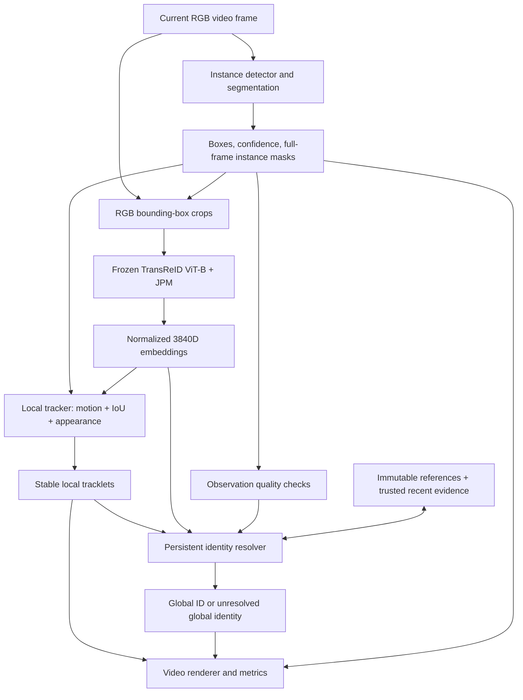

# Experimental architecture: local tracklets and global identity memory

The default live engine is now the exact measured local-tracker reference. This document describes the retained experimental global resolver; see [reference and recovery-budget workflow](recovery_budget.md).

The detector and ReID specialist are unchanged. The association stage now has two independent responsibilities:



Default commands from `capstone/reid`:

```bash
../.venv/bin/python demo.py vehicle
../.venv/bin/python benchmark.py vehicle
```

Settings live in `configs/vehicle_reid.yaml` and `configs/vehicle_benchmark_tracklets.yaml`. Device selection is always automatic. The reference video path is `data/videos/vehicle_reference/annotated.mp4`; the new comparison writes to `metrics/vehicle_benchmark_tracklets_stable/`. The initial split comparison is preserved in `metrics/vehicle_benchmark_tracklets/`; the original v1 results remain under `metrics/vehicle_benchmark/`. The original pipeline configuration is preserved as `configs/vehicle_reid_v1.yaml`.

## Visual computation

See the [Co-DINO, RF-DETR, and YOLO comparison](detector_frontends.md) for released-checkpoint detection/mask metrics and the boundaries of the local measurements.

The live detector is the existing Co-DINO ViT-L + RefineMask vehicle model. The fixed-detector comparison uses its cached predictions. The adapter returns xyxy boxes, scores, and full-image instance masks. Mask R-CNN has been removed from the current pipeline. The normal command automatically starts the existing isolated Co-DINO runtime; no environment/backend flags are needed. Detection runs on every frame; no Cutie/EdgeTAM propagation is currently included.

ReID is a separate trained TransReID specialist. Each RGB bounding-box crop is resized to 256×256 and normalized with mean/std 0.5. It is not background-erased or mask pooled. ViT-B/JPM returns one 768D global feature plus four 768D local features, each local part scaled by 1/4. The concatenated 3840D vector is L2 normalized. Source camera/view embeddings are disabled. Detection and ReID do not share a visual encoder.

Masks guide observation-quality checks, rendering, and evaluation. Accurate masks are not treated as identity proof. Both visual networks remain frozen during inference; this change introduces no learned model parameters. Classifier heads, label-smoothed classification/triplet losses, identity-balanced sampling, augmentation, optimizers, and gradient checkpointing belong to the existing specialist training path only.

## Local continuity

`utils/vehicle_reid/tracklets.py` wraps the existing `VehicleTracker` implementation as the local tracker. Inputs are current-frame boxes and embeddings. The unchanged local settings combine constant-velocity box prediction, IoU, cosine appearance, a center-distance gate, and Hungarian assignment. The retention window is 15 frames, matching the previously measured baseline.

Every valid observation gets a local tracklet ID, including observations that are unsuitable for persistent ReID enrollment. An uncertain observation can update position/continuity but cannot update an existing local appearance vector. New local tracklets may initialize an appearance hypothesis from the current embedding; this does not enroll it as trusted global evidence. Local tracker appearance and global identity memory are separate state.

Local continuity is never rejected because a spatially unrelated object has similar global appearance. A visible local tracklet already bound to a global ID retains that binding. Short occlusions may be bridged by the local tracker using its ordinary motion/appearance constraints; those decisions inherit the measured local tracker's limitations.

## Global identity and memory

A binding maps a local tracklet to a persistent identity. It does not define the local tracklet's existence.

For an unbound tracklet, only persistent identities absent from the current frame can be recovery candidates. Identities already owned by another visible tracklet are excluded. This is a single-stream ownership rule, not a simultaneous multi-camera fusion implementation. A successful recovery transfers ownership and removes the old local binding; it never rewrites previously emitted video or evaluation IDs.

Recovery keeps the frozen v1 settings: score at least 0.82, reference cosine at least 0.70, margin at least 0.08 against competing identities and unresolved tracklets, and three consecutive reliable observations on the same local tracklet proposing the same identity. The score is 70% reference similarity plus 30% best recent similarity. No old-view coordinate constraint participates in global matching. Local tracklet continuity supplies the temporal evidence, replacing the previous ad hoc pending-box IoU check.

A reliable unbound tracklet may enroll a new persistent ID when its best absent-identity score is below 0.55. Three clean observations confirm automatic enrollment. Explicit target selection enrolls/confirms a reliable selected reference immediately. Confirmed identities persist after their local tracklets expire. A target profile imports the selected appearance evidence and resets all local motion, ownership, and pending evidence for another video/view.

Each identity retains an immutable enrollment reference and up to eight recent vectors. Writes require reliable observations, four consecutive clean hits, score at least 0.85, reference agreement at least 0.70, and margin at least 0.10. Recovery itself never immediately updates memory. Similar-looking vehicles can therefore maintain separate local tracks even when global appearance memory cannot confidently distinguish them.

## Rejection and metric semantics

An unresolved global match is rendered as a stable `L<number>` local ID, with an explicit `rejected`, `ambiguous`, or `pending_recovery` status. It is not presented as the selected target. Once sufficient evidence identifies the old target, its original global ID is emitted from that frame onward.

Every new local tracklet reserves an output ID immediately, even before it has trusted global evidence. Enrolling its first reference reuses that reserved ID, so enrollment does not rename an already visible track. A confident recovery of a previously known object may transfer its old ID to the new tracklet from that frame onward; there is no retrospective merge. The superseded local owner loses that output-ID reservation, preventing duplicate IDs if it later reappears. Recovery metrics use the actual emitted tracking identity while separately counting observations with unresolved global identity. Thus retaining a local track cannot be mistaken for successful cross-camera identification.

The v1 memory baseline remains unchanged and still exports rejected observations as one-frame IDs. The new comparison includes both variants, the existing tracker with specialist/joint features, ByteTrack, and OC-SORT. The change was motivated by previous validation failures, so results on those same nine sequences are development comparisons rather than an untouched final test. No recovery thresholds or local parameters were swept against those scores.

## Modules and inference interfaces

| Module | Input | Output |
|---|---|---|
| `models.Detector` | Current frame | Boxes `N×4`, scores `N`, masks `N×H×W` |
| `models.Embeddings` | Current RGB frame + boxes | Normalized specialist embeddings `N×3840` |
| `models.observations` | Instance predictions | Valid clipped boxes and reliability flags |
| `TrackletAssociation.local` | Boxes + embeddings | Stable local tracklet IDs and spatial state |
| `TrackletAssociation` resolver | Local tracklets + reliable appearance + absent memory | Persistent global IDs or unresolved identity, guarded memory writes |
| `pipeline` | Decisions + frame/masks | Annotated video, state checkpoint, timings, optional diagnostics |
| `benchmark` | Same fixed observations + methods | TrackEval, recovery counts, per-sequence paired uncertainty |

The legacy `association.py` is retained as the v1 reference. `tracklets.build()` selects the configured association engine. State checkpoints include local motion, bindings, pending recovery counts, global references/recent memory, and target selection, so interrupted recovery can resume exactly. Loading a target profile imports only its selected global appearance evidence. No future frames or GT labels enter either association stage.

## Verification of this revision

On the same nine KITTI validation sequences and fixed Co-DINO observations, the final stable-ID revision measures **79.46 HOTA / 87.31 IDF1**, compared with **79.46 / 87.35** for the existing specialist tracker and **38.83 / 29.52** for v1 memory. It restores baseline-level continuity; it is not an established accuracy improvement. The first split implementation (before reserving output IDs at birth) is preserved at **71.35 / 74.68** under `metrics/vehicle_benchmark_tracklets/`.

Natural visibility-return recovery is 9/26 events, compared with 6/26 for the existing specialist tracker. The separate matched-observation-gap diagnostic counts 20 false reconnections versus 14 for that baseline; this aggregates local and global continuity decisions and is not the precision of the global resolver alone. These small event counts and the paired sequence intervals do not establish superior long-term ReID. See [current executed scorecard](../../metrics/vehicle_benchmark_tracklets_stable/scorecard.md).

Verification includes 29 passing tests, live Co-DINO/TransReID inference over 80 training/development frames, stable local output on 70 real cached frames even when every appearance observation is marked unreliable, resumed 8+4 versus uninterrupted 12-frame live inference with equivalent identity/motion/memory state, and target-profile restart recovering the original identity after three observations.
