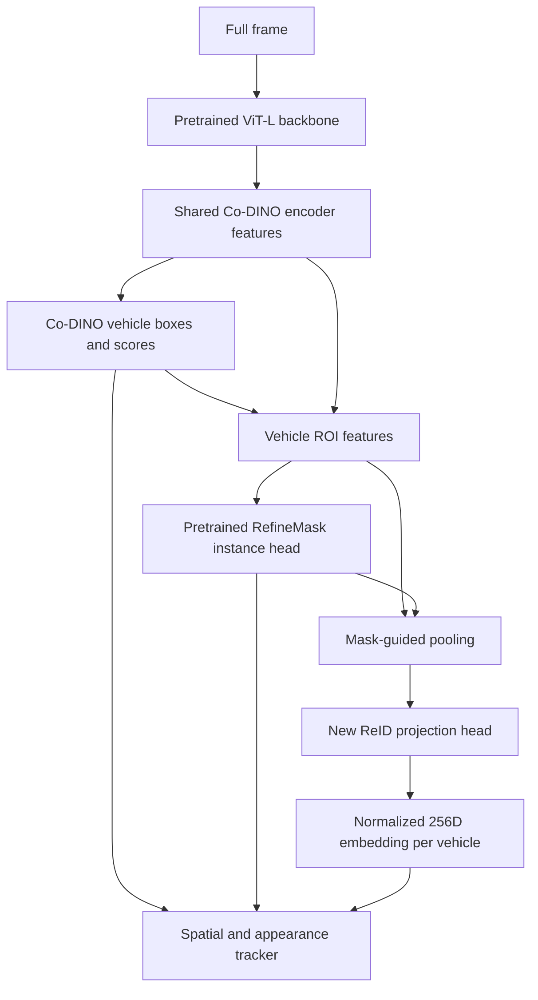

# Accuracy-first vehicle teacher

## Run it

From `capstone/reid`, with your normal `.venv` active:

```bash
python train.py teacher
```

The separate environment, pinned source, and verified pretrained weights are
already installed on this machine. The command launches the teacher environment
automatically. For an SSH run:

```bash
tmux new -s vehicle-teacher
python train.py teacher
```

Detach with **Ctrl+B**, release, then **D**. Reattach with
`tmux attach -t vehicle-teacher`. Closing SSH after detaching leaves training
running on this host.

Configuration: [`configs/teacher.yaml`](../configs/teacher.yaml). Training runs
12 epochs. The last checkpoint saves every 250 KITTI pair steps and at each epoch
boundary. Run the same command again to resume the last completed save. An
interruption can lose work since that save. The full model, optimizer, AMP scaler,
epoch/step, sampler, and random states are saved. Files are replaced atomically.
Do not run two writers against the same checkpoint paths.

Other commands:

```bash
python train.py teacher-check
python benchmark.py teacher
```

The check does short real-data optimizer updates and a temporary tracking export;
it does not save trained weights or publish benchmark scores. Evaluation also
runs automatically after training. Final evaluation requires a completed run.
On another machine, use `python train.py teacher-setup` first. Setup needs
Miniconda, a compatible NVIDIA GPU/driver, network access, and the prepared data.
The teacher has its own Python 3.10 environment at `capstone/.teacher-env` because
the released Co-DETR code uses an older PyTorch/MMCV stack.

## Architecture



This is **one shared network for boxes, masks, and embeddings**, followed by an
external association algorithm. It predicts an instance mask for every retained
vehicle. The ReID loss also flows through the soft predicted masks used for
pooling. Binary masks are used for the final tracking export.

The released Co-DINO-Inst ViT-L detector and RefineMask weights are loaded from
the authors' checkpoint, including their COCO class predictors. We retain all
80 classifier outputs to preserve initialization and supervise/select the car
class. The added ReID projection and identity classifier are **new parameters**;
there is no pretrained all-in-one vehicle ReID checkpoint in this implementation.
The training identity classifier is unnecessary for deployment embeddings.

Source and weight revisions and the weight SHA-256 are recorded in the config.
The upstream EMA checkpoint stores its evaluation weights under normal parameter
names; its extra `ema_*` buffers hold the training copy and are excluded on load.
All remaining parameter keys must match the released instance configuration.

## What gets trained

| Data | Supervision | Partition |
| --- | --- | --- |
| COCO | Released detector and instance-mask initialization | Pretraining, not a local download/training step |
| KITTI MOTS | Car boxes derived from instance masks, true instance masks, sequence-local track IDs | Conventional 12 training sequences; all 9 validation sequences excluded |
| VRAI | Vehicle identity classification and cross-camera triplet loss | 52,966 images / 5,042 training IDs from the current manifests |
| VRAI calibration | Select best epoch by mAP | Fixed 128-ID subset of separate calibration identities |
| VRAI final query/gallery | Final Rank-1 and mAP | All 630 held-out identities; excluded from training and epoch selection |

The current KITTI partition supplies 4,050 consecutive frame pairs and 431
sequence-local car identities. Labels from separate sequences/datasets receive
separate classifier indices. Data loading checks VRAI identity separation and
query/gallery camera separation. BuckTales is not used for training or selection.

One optimizer update uses a KITTI pair: the original Co-DINO box/classification
and auxiliary losses, RefineMask losses, mask quality losses, plus ReID identity
classification and batch-hard triplet loss. After every two KITTI pair updates,
another update uses four VRAI identities with two cameras per identity. VRAI
crops have no mask labels: their identity loss trains through predicted masks;
KITTI supplies actual segmentation supervision. Each epoch samples 16,200 VRAI
crops; sampling does not guarantee visiting every VRAI image within an epoch.

For the first two epochs, the backbone is frozen while the pretrained task heads
and new identity head adapt. Then the last four ViT blocks are unfrozen at a
smaller learning rate. This is partial backbone fine-tuning to fit the available
24 GB GPU. Training uses cosine learning-rate decay, gradient clipping, activation
checkpointing, mixed precision in the backbone, and FP32 task heads because the
released losses and deformable-attention kernels require that precision.

Full frames preserve aspect ratio with short side 384 and long side capped at
1280; VRAI crops preserve aspect ratio inside a 384-pixel cap. This is not the
original paper's full training recipe or test-time augmentation. KITTI uses
horizontal flips and brightness variation. VRAI uses its existing color,
grayscale, and flip augmentation. No disk copies of augmented images are created.

## Outputs and interpretation

- `checkpoints/teacher/co_dino_joint.last.pt`: resumable checkpoint.
- `checkpoints/teacher/co_dino_joint.best.pt`: best calibration-mAP model.
- `metrics/teacher/training.csv`: sampled losses and epoch calibration scores.
- `metrics/teacher/summary.html`: held-out retrieval and KITTI tracking scores.
- `metrics/teacher/vrai.csv`: mask versus global pooling on the same checkpoint.
- `metrics/teacher/kitti_mots/summary.html`: HOTA, DetA, AssA, IDF1, sMOTSA,
  MOTSP, identity switches, TP, FP, FN from official TrackEval.
- `metrics/teacher/timing.csv`: per-sequence frame latency and hardware.
- `data/kitti_mots/teacher_benchmark/`: required RLE tracking predictions and
  provenance/timing metadata, cached by completed sequence for evaluation resume.

There are no visualization PNG, JSON, or NPZ dumps in this workflow. The report
is HTML; the RLE text files are necessary evaluator inputs, not video previews.
A teacher selection/MP4 visualization interface has not been added yet.

The earlier **60.8% recall was mask-based MOTS matching**, not isolated box
recall. A detection can fail that metric because its box is missing, its score
is below threshold, or its mask overlaps the truth poorly. A stronger teacher
is an experiment to improve these failures, not a guaranteed recall increase.

Compare the earlier clean KITTI checkpoint on the same validation sequences.
Report extra VRAI training, resolution, threshold, backbone, and training budget:
this teacher changes several things and cannot identify the cause of a gain by
itself. Timing includes PNG decoding, the model, tracking, and RLE export at
batch 1, with a mixed precision backbone and FP32 heads; initialization is
excluded. This is not TensorRT or AI Camera latency.

## Why this teacher, and what remains

Co-DETR is a strong, released **ICCV 2023 reference**, not a verified claim to
the universal November 2026 state of the art. The authors report COCO validation
65.3 box AP / 56.2 mask AP without test-time augmentation, and 65.8 / 56.6 with
augmentation. Those are published COCO scores, not our KITTI or VRAI scores.
It provides trained boxes and instance masks in a shared feature architecture
that we can extend for ReID. It is much larger than the intended student.

After measuring this teacher, the next work is a smaller student with matched
evaluation, then distillation of detections, masks, and identity embeddings.
**Distillation, quantization, and `.rpk` export are not implemented here.** No
Pi/AI Camera compatibility or speed is established for this teacher. Better
appearance embeddings alone also do not make the current tracker state of the
art; compare association algorithms separately with fixed model predictions.

Sources:

- [Official Co-DETR repository](https://github.com/Sense-X/Co-DETR)
- [Authors' released instance checkpoint and scores](https://huggingface.co/zongzhuofan/co-detr-vit-large-coco-instance)
- [Co-DETR paper](https://openaccess.thecvf.com/content/ICCV2023/html/Zong_DETRs_with_Collaborative_Hybrid_Assignments_Training_ICCV_2023_paper.html)

## Code map

| File under `utils/teacher/` | Responsibility |
| --- | --- |
| `settings.py` | Config paths and conventional split guard |
| `assets.py` | Pinned source and resumable, verified pretrained download |
| `launcher.py`, `requirements.txt` | Isolated environment setup and launch |
| `model.py` | Shared detector, instance masks, mask pooling, identity losses |
| `data.py` | KITTI pairs, VRAI sampling and identity separation |
| `training.py` | Fine-tuning schedule, optimizer, checkpoint selection and resume |
| `retrieval.py` | Camera-filtered retrieval and pooling ablation |
| `evaluation.py` | Final retrieval, complete sequence export, metrics HTML |
| `runtime.py` | Environment entry point and real-data checks |

The existing KITTI loader, VRAI sampler, tracker, and TrackEval adapter are reused
from `utils/full_frame/`. Pinned third-party source lives in the ignored
`utils/vendor/Co-DETR/` directory. Run the root scripts, not these implementation
modules directly.
