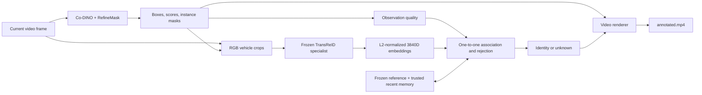

# Vehicle identity pipeline

The live default is the accuracy reference; global recovery is experimental and evaluated under a [development-only recovery budget](archive/recovery_budget.md).

The current association uses [separate local tracklets and global recovery](archive/vehicle_tracklets.md). The initial memory design and measurements below are retained as historical v1 context.

The runnable baseline is **instance segmentation → independent TransReID specialist → conservative identity association → annotated MP4**. Use `demo.py vehicle` for video and `benchmark.py vehicle-retrieval` for separate cross-camera evaluation; `benchmark.py vehicle` runs the full quantitative suite. Implementation lives in `utils/vehicle_reid/`; existing training and benchmark commands remain available.

## Architecture and interfaces



| Module | Input | Output / responsibility |
|---|---|---|
| `pipeline.Source` | MP4 or numbered, contiguous PNG/JPG directory | Sequential BGR `H×W×3` frames and source frame numbers; resume uses sequential decode for videos |
| `models.Detector` | Current frame | `N×4` xyxy boxes, `N` scores, boolean `N×H×W` masks; Co-DINO and explicit offline cache replay |
| `models.observations` | Frame and instance predictions | Clipped valid boxes; reliability flags based on confidence, size, truncation, mask coverage, and box overlap |
| `models.Embeddings` | Current frame and valid boxes | `N×3840` normalized specialist vectors; bounded batches; exact checkpoint preprocessing |
| `association.Association` | Boxes, vectors, reliability, increasing frame index | Identity/status/similarity/margin/memory-update decisions; persistent appearance, local spatial state, pending recovery evidence |
| `evaluation.Diagnostics` | Decisions already made, masks, optional KITTI truth | Counts of correct/wrong assignments, reconnections, missed/delayed returns, target misses; truth never enters association or selection |
| `pipeline.render` | Frame, masks, decisions, evaluation labels | Annotated video, selected-target visibility, explicit unknown labels |
| `retrieval` | Audited VRAI query/gallery manifests | Separate closed-set retrieval and open-set acceptance/rejection summaries, resumable crop inference |

Keep the existing detector and masks because their weights, source, and integrations are present. Use the finalized specialist selected on calibration IDs: `checkpoints/reid_teacher/selected.yaml`. Its saved final report is 92.89% Rank-1 / 92.33% mAP on the repository's local VRAI split. These are crop retrieval results, not video tracking accuracy. There is no new training prerequisite.

The live path uses the existing Co-DINO vehicle checkpoint. Mask R-CNN has been removed from the current pipeline; old measurements remain historical records. Existing shared-model baselines and evaluation tools are retained. Upstream implementations: [Co-DETR](https://github.com/Sense-X/Co-DETR), [TransReID](https://github.com/damo-cv/TransReID). Local pinned source and weight hashes remain authoritative.

## Feature path and training

Inference takes the original RGB bounding-box crop, resizes it to **256×256**, converts it to a tensor, and normalizes each channel with mean/std 0.5. This is square resizing of the rectangular crop, matching the trained specialist; it is not aspect-preserving letterboxing. Masks do not erase crop pixels or pool the specialist's features.

The loaded specialist is ViT-B with stride 12 and JPM: global 768D feature concatenated with four 768D local features scaled by 1/4, then whole-vector L2 normalization. It uses features before the BN neck. Source camera/view side embeddings are disabled, so a new camera requires no source-camera index. No test-time reranking or future-frame smoothing runs.

The existing `utils/reid_teacher/` training path remains the training implementation. It uses 8 identities × 4 crops: two cameras per identity, two images per camera. Training/calibration/final identities and image paths must be disjoint; query/gallery cameras and paths must be disjoint. The full manifests are checked even for smoke subsets. Current counts: 5,042 train identities / 52,966 crops, 630 calibration identities / 1,228 query + 2,179 gallery, and 630 final identities / 1,223 query + 2,199 gallery.

Training averages label-smoothed identity cross-entropy over global/local classifiers and adds average batch-hard triplet loss over normalized global/local features (margin 0.3). Classifiers warm up for one epoch, then the full specialist is fine-tuned with AdamW. Best weights are selected using calibration mAP, not final identities. Existing training checkpoints include optimizer/scaler, sampler and random states, epoch/step, and data/config signatures.

**Online components:** frame decode, full detector/mask inference, crop preprocessing, specialist, reliability checks, association, memory, rendering/encoding, and periodic state writes. The Co-DINO adapter currently calls the existing joint forward, including its small unused ROI ReID projection; this overhead is included in measured detector cost.

**Training-only components:** identity classifiers/losses, triplet mining, augmentations, optimizer, scaler, gradient checkpointing, and training identity labels. Dataset truth is optional evaluation-only input. Distillation, a shared encoder, propagation networks, geometry, camera calibration, and future frames are absent from the new inference path.

## Memory, matching, and rejection

Each new reliable, sufficiently different observation seeds a tentative ID with an immutable reference vector. Three consecutive accepted observations confirm an automatically discovered object. Explicit target selection enrolls its reliable first observation immediately, so an early disappearance cannot erase the selected reference. Confirmed identities survive disappearance indefinitely; tentative clutter expires after five frames. Per-ID appearance storage is one frozen reference plus eight trusted recent vectors. Total identity count can grow over a long stream; the first version intentionally does not evict confirmed identities.

Appearance score is `0.7 × best reference cosine + 0.3 × best recent cosine`; reference cosine substitutes for recent cosine when recent memory is empty. Current implementation keeps one reference, with a list interface for future multi-reference enrollment. Recent evidence never replaces the reference.

Active continuation requires cosine ≥ 0.65, box IoU ≥ 0.05, a gap of at most two frames, and an appearance margin ≥ 0.04. This is deliberately a simple local coordinate check, without motion extrapolation. Lost-track recovery uses **no old-image coordinate gate**: score ≥ 0.82, reference similarity ≥ 0.70, margin ≥ 0.08, and three consecutive observations of the same candidate. Consecutive recovery candidates must overlap within the current view; old-view coordinates are never compared. A new camera/profile resets boxes, frame counters, and pending evidence.

Hungarian assignment enforces one-to-one matching. Margins are checked against both other identities for the observation and other observations for the identity, including appearance competitors that fail spatial gates. Ambiguous matches and plausible old identities below recovery confidence stay unknown. A new tentative ID is created only from a reliable observation whose best old-identity score is below 0.55. Thus a similar-looking genuinely new vehicle may remain unknown; this is a precision-first policy, not evidence that it is the old vehicle.

Recent memory updates require reliable detections, a confirmed identity, four continuous accepted hits, score ≥ 0.85, margin ≥ 0.10, and reference agreement ≥ 0.70. A recovery observation never immediately updates memory. Low-quality active observations may maintain continuity but cannot write appearance. Confidence, overlap, and mask-coverage checks are heuristics; they do not certify absence of occlusion. There is no guarantee against a highly confident visual impostor. Thresholds are initial operating settings, not calibrated guarantees.

## Commands

Run from `capstone/reid`. Paths in YAML resolve from that directory, regardless of the shell's working directory.

```bash
# Default live run: input, output, frame count, and backend come from YAML.
../.venv/bin/python demo.py vehicle

# Accuracy path on a working CUDA host, using the existing teacher environment.
../.teacher-env/bin/python demo.py vehicle --backend codino

# Cheap integration replay: detector is OFFLINE, specialist still runs on current crops.
../.venv/bin/python demo.py vehicle --backend cache \
  --frames 40 --output data/videos/vehicle_replay \
  --truth data/kitti_mots/instances_txt/0010.txt --target-truth-id 1000

# Resume or extend the same run. --frames is total requested frames, not extra frames.
../.venv/bin/python demo.py vehicle \
  --frames 1000 --output data/videos/vehicle_live --resume

# Reuse the selected target after restart or in another camera/video.
# ReID checkpoint must match. New run discards all old spatial state.
../.venv/bin/python demo.py vehicle \
  --source /path/to/other_camera.mp4 --output data/videos/other_camera \
  --profile data/videos/vehicle_live/state.pt

# Long video job; rerun the same command with --resume after interruption.
tmux new -s vehicle '../.teacher-env/bin/python demo.py vehicle --frames 10000 --output data/videos/vehicle_long 2>&1 | tee /tmp/vehicle-long.log'

# Existing specialist training automatically resumes from its configured checkpoint.
tmux new -s specialist '../.venv/bin/python train.py reid-teacher 2>&1 | tee /tmp/specialist.log'

# Cross-camera smoke check; separate from video identity metrics.
../.venv/bin/python benchmark.py vehicle-retrieval --stage calibration --limit-identities 8

# Full calibration and then untouched final cross-camera evaluation.
# Use --resume to continue extraction, including after the job finishes.
tmux new -s retrieval '../.venv/bin/python benchmark.py vehicle-retrieval --stage calibration 2>&1 | tee /tmp/retrieval.log'
../.venv/bin/python benchmark.py vehicle-retrieval --stage calibration --resume
../.venv/bin/python benchmark.py vehicle-retrieval --stage final

# Deterministic association and diagnostic checks.
../.venv/bin/python -m unittest discover -s utils/vehicle_reid/tests -v
```

Device selection is always automatic: CUDA when available, otherwise CPU. Commands require no device flag; the optional `--device auto` spelling is also accepted. Live Co-DINO requires CUDA. CPU supports offline cache replay; no detector fallback is substituted. The normal command automatically launches the existing Co-DINO environment.

Edit `configs/vehicle_reid.yaml` for input, FPS, camera label, thresholds, target selection, and optional labeled evaluation. `select: largest` selects the largest reliable first-frame mask. `select: [x, y]` selects the predicted mask under that source-frame point. `select: null` tracks all vehicles. Use `start_frame` if the target is not present/reliable initially. Profile export is the normal `state.pt`, and requires a selected, confirmed target; no separate feature/image export command is needed.

For KITTI video diagnostics, set `evaluation.truth: data/kitti_mots/instances_txt/0010.txt`. If assessing a selected target, set `target_truth_id` from its ground-truth identity **for scoring only**. It never selects or associates the target. Set `camera` and source consistently yourself; a camera cut inside one file is not automatically detected. Split it into another profile run to explicitly reset spatial evidence.

## Outputs, resume, and cost

Each run produces `annotated.mp4`, `state.pt`, `summary.yaml`, and small per-segment timing CSVs. Committed `part*.mp4` segments allow crash-safe resume; ffmpeg remuxes them into the primary `annotated.mp4` without re-encoding. Segments are intentional resume artifacts, not image/feature dumps. No per-frame masks, crops, JSON, NPZ, or embedding exports are written. Rendering trims at most the last image row/column to obtain even video dimensions.

Every 25 frames, close and commit the segment, write timings, then atomically save identity/target/evaluation state and the next frame position. If interrupted, at most the current uncommitted segment is recomputed. Restart overwrites orphan segments at the saved part index. Resume rejects changed source metadata, settings, or model signatures; only the requested frame count may change. Use a new output for changed settings. Load only locally trusted state checkpoints (they contain Python runtime state). `--profile` imports only the selected target's identity evidence into a fresh run.

Timing CSVs separate decode/detector/quality, specialist, association, optional evaluation, and rendering/encoding. CUDA timing synchronizes around GPU stages. `summary.yaml` reports invocation wall FPS including segment finalization and checkpoint/report I/O; initialization and resume seek are reported separately. Offline replay carries historical detector timings in a separate column and explicitly labels throughput as replay; do not add GPU historical latency to current CPU measurements and call it online FPS. Cross-camera crop throughput excludes the detector and is labeled accordingly. Timing from simultaneous jobs is not an isolated benchmark.

## Evaluation and current verification

Within-video diagnostics use one-to-one mask IoU matching against optional KITTI truth after association. They report correct/wrong identity observations, correct/false/unscored reconnections, target false matches, target-visible misses, return events missed on the first returning frame, delayed recoveries, and accumulated visible missed-recovery frames. Return is defined by a gap in GT visibility. Cases still pending at stream end are accessible in checkpoint diagnostics. These counters complement, rather than replace, full IDF1/HOTA/sMOTSA evaluation in the existing KITTI tools. The new runner does not yet export its predictions into TrackEval.

Cross-camera evaluation independently reports Rank-1/mAP using all selected query/gallery identities. Its open-set protocol keeps one frozen gallery reference per known ID and removes every fifth sorted gallery identity, creating queries for genuinely unknown vehicles. It applies the configured cosine and identity margin, counting correct accepts, wrong-known accepts, rejected-known queries, unknown false accepts, and correct unknown rejections. Retrieval does not apply video temporal confirmation. Choose thresholds on calibration data only, freeze YAML, and use final IDs only for reporting. Do not copy closed-set mAP into a tracking accuracy claim. Video thresholds also require labeled video calibration.

Completed in this session:

- Specialist/source/checkpoint and full VRAI partition checks; successful specialist loading in modern and teacher environments. Fixed missing `torch._six.container_abcs` compatibility for Torch 1.13.
- Live CPU Mask R-CNN + TransReID on real KITTI frames, MP4 decoding, rendering, and resumed processing; resumed 8+4 and uninterrupted 12-frame runs had identical identity state and diagnostics.
- Saved-target reuse: two pending observations, then original-ID recovery on the third observation using real frames.
- Forty real KITTI frames with cached Co-DINO masks and live specialist inference: selected GT vehicle 1000 correctly associated on all 40 frames. This interval has no selected-target disappearance; it does not establish long-gap performance.
- Separate 8-ID cross-camera calibration smoke: 16 queries, 32 gallery crops; closed-set Rank-1/mAP 100% on this small subset; 7/12 known queries correctly accepted, 5 rejected, 0 wrong-known accepts, 4/4 unknown queries rejected. Full saved specialist results are a separate existing report.
- Twelve association/diagnostic tests cover ambiguous lookalikes, competing detections, protected memory, view reset, interrupted recovery, new/unknown identities, wrong reconnection accounting, and detector-missed/delayed return accounting.

No working CUDA driver was available (`nvidia-smi` failed), so the combined Co-DINO + specialist GPU path and its throughput remain unverified. The teacher environment can now load the specialist; this does not prove the complete GPU integration. No full new cross-camera evaluation or long-occlusion benchmark was run. The small smoke results are not operating-point guarantees.

## Full quantitative comparison

The smoke checks above are integration checks. The full benchmark subsequently exposed a severe identity-fragmentation regression in this initial persistent association. See [executed scorecard](../metrics/vehicle_benchmark/scorecard.md) and [benchmark commands and protocol](vehicle_benchmark.md). The initial memory tracker should not be described as a measured improvement.

## Next integration boundary

The smallest complete pipeline runs detection on every frame. Existing Cutie/EdgeTAM experiments remain separate. After a labeled long-return baseline is established, add propagation behind the same observation interface, mark propagated observations as ineligible for memory writes, and require fresh detector/specialist evidence for recovery. Measure the propagation network plus detector refreshes and specialist calls together. Any shared visual encoder or distillation change should retain this specialist path as its measured retrieval/rejection reference.
